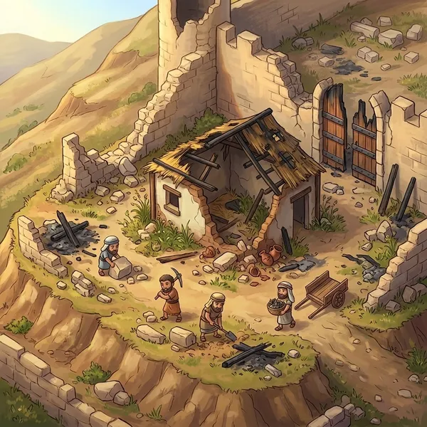
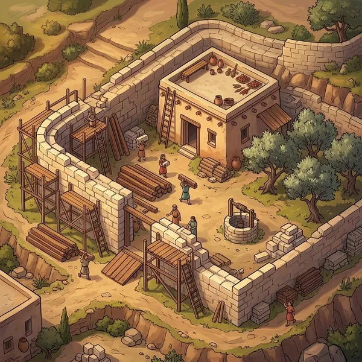
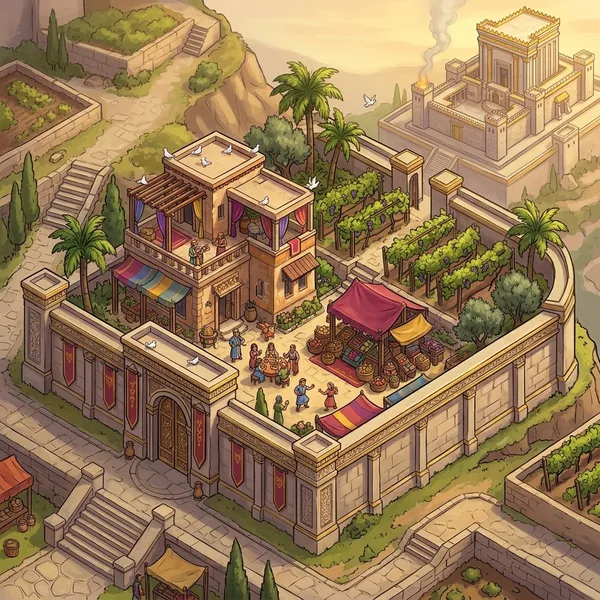

# What coins buy — concept

Status: **proposal** (2026-10-29). Coins are already earned and saved:

- 10 per correct answer.
- +5 per correct answer on a 3+ streak.
- A finishing bonus of 50/30/20 for the top three, 10 for everyone else.
- Half rate (5 per correct answer) in Practice.

All of these live in `shared/src/coins.ts`. Coins buy Jerusalem materials (`docs/jerusalem-plot.md`) and look items (below).

## Design rules

1. **Nothing coins buy affects quiz scoring.** Knowledge wins matches, not
   wallets, so a new player can win their first arena game.
2. **No real-money purchases.** For a church/family audience, coins come only
   from playing. That also avoids app-store payment rules and any whiff of
   "gambling".
3. **Every purchase teaches something.** Each item carries a short Bible
   reference, so the shop doubles as a second learning surface.
4. **Progress is visible to others.** It shows on your profile, which other
   players can open from the leaderboard or the crowning.

> The detailed plot / buildings / shop / timers design is in `docs/jerusalem-plot.md`.
> Coin rates below are outdated: see `shared/src/coins.ts` (arena > Blitz > Practice).
> Exodus, the runner, pays mostly XP and at most 60 coins a run (`EXODUS_REWARDS`; about half Bible Blitz's coins a minute, so it can't be farmed): `docs/exodus.md` → Rewards.

## Recommended: "Rebuild Jerusalem" — your own plot, from rubble to glory

The story fits the game well. In **Nehemiah 3**, every family repaired *the
section of the wall in front of their own house*, and together the city rose
again. Each player gets **their own plot of Jerusalem** and rebuilds it with
coins.

| Ruins | Rebuilding | Thriving |
|---|---|---|
|  |  |  |

*(Concept art generated with the art pipeline. The real version would be
layered pieces that change one by one.)*

### A city that grows with its players

- **Every new player gets a plot** when they first open the game. They receive
  it by *casting lots*, which is what Nehemiah 11:1 describes: "the rest of the
  people cast lots to bring one of every ten to live in Jerusalem".
- The city is a grid that grows outward, so it scales without limit:
  - the Temple mount sits in the centre;
  - plots fill rings around it, inside the wall first, then outside the gates.
  - Friends or a church group can ask for **neighbouring plots**, which makes a
    street.
- **Extra plots are bought with coins.** The first extra plot borders your own
  and becomes a field, vineyard or pasture. Prices rise for each additional
  plot, so this is a long-term goal rather than a land grab.
- A plot is **data, not an image**: a position plus the level of each building.
  The client draws it from shared layered art, so 10 or 100,000 players cost the
  same in art. The city view loads only the plots on screen.

### What you build

Each building has 3–5 visible upgrade levels. Each level costs coins **and**
asks for materials, which teaches the biblical building materials.

| Building | Levels (examples) | Verse hook |
|---|---|---|
| Wall section | rubble → stones → full wall → towers → gilded gate | Neh 2:17, 3:28 |
| Family house | tent → mud brick → stone → two storeys → roof garden | Deut 22:8 (parapet!) |
| Well | dug pit → stone well → cistern | Gen 26:18 |
| Garden / vineyard | weeds → olive trees → vineyard → orchard | Isa 5:1–2, Mic 4:4 |
| Workshop | carpenter → potter → weaver → goldsmith | Ex 31:1–6 (Bezalel) |
| Market stall | basket → stall → caravan stop | Neh 13:15–16 |
| Gate (landmark) | Sheep Gate, Fish Gate, … one per player | Neh 3 (named gates) |

**Materials** have prices in coins: stone, cedar (from Lebanon, 1 Kgs 5:6),
bronze, gold, fine linen and olive oil. Buying a level means buying its
materials first, a light crafting layer. It is also a natural place to show
"you have 3/5 cedar beams".

**Pacing.** One average arena game earns about 100–150 coins.

| Purchase | Cost in coins | Takes |
|---|---|---|
| First upgrade | 100 | 1 game |
| Mid-tier | 500–1,500 | about a week of casual play |
| Landmark gate | about 5,000 | a long-term goal |

A fully restored plot takes about 3 months of weekly play, and we can keep
adding new buildings.

### The shared goal: Solomon's Temple (group/church level)

- In the arena, a **group** (for example a church youth group with a saved
  group code) contributes a share of every game's coins to a **shared Temple**.
  It goes up in stages: foundation → walls → pillars Jachin & Boaz → the
  Holy Place → dedication (1 Kgs 6–8).
- Everyone sees their name on the donor stones. The Temple appears on the
  hill behind every member's plot, as in stage 3 above.
- This turns individual play into a group project, a reason to come back next
  week.

## Second coin sink: characters and looks (built, 2026-10)

Cosmetics show up in every game, which is what makes them worth having. The
rules and the item table are `shared/src/looks.ts`; the picker is
`app/src/looks/LookPicker.tsx` (Profile, and the join screens of the arena and
board games); the Market screen links to it.

**Free for everyone, guests included:**

- **24 characters**: David, Moses, Esther, Ruth, Abraham, Sarah, Noah, Rebekah,
  Joseph, Miriam (as a girl), Deborah, Gideon, Hannah, Samuel (as a boy),
  Elijah, Naomi, Daniel, Mary, Peter, John, Martha, Lydia, Paul, Priscilla.
- **3 skin tones** each (light, olive, dark), painted as the same person.
- Frames *gilt edge* (the default) and *wood*; backdrops crimson (default),
  sand, sky, meadow.

**Market (signed-in players, 100–1,000 coins):**

| Slot | Items (price) |
|---|---|
| Head | red / blue headband (100), green (150), purple (200), flower crown (300), olive wreath (400), linen turban (500), coin headdress (800) |
| Neck | leather cord (100), wooden beads (200), shells (300), amber (500), silver chain (700), gold chain (1,000) |
| Frame | bronze (250), silver (500), gold (900) |
| Backdrop | sea (200), royal purple (400), sunset (600), starry night (800) |

**Rare, earned and never sold** (the picker shows how, with progress):

| Item | How |
|---|---|
| Golden circlet (head) | win 10 Open Arena games (`stats.arenaWins`) |
| Scholar's turban (head) | spend 6 points on the Scholar path of the Gifts tree |
| Golden laurel (head) | reach level 20 |
| Pearl of great price (neck, Matt 13:46) | answer 1,000 questions right |
| Jewelled frame | read the Daily Scroll 30 days in a row (`stats.bestDailyStreak`) |

`arenaWins` and `bestDailyStreak` are new account stats (counted from
2026-10, reported with the arena podium / finished scroll grants like every
other stat).

**How ownership works.** The wardrobe is `profile.wardrobe` in the account
(a list of item ids, like the skill ranks), changed only by the server:
`POST /api/looks/buy { item }` checks the price against the server's coins,
deducts them and replies with the account (the app adopts it, coins included);
`/api/account/sync` adds rare items once their condition is met (kept after a
re-spec) and strips any worn item the account doesn't own. Sign-up starts
with free items only.

**How a look travels.** One string in the old `avatar` field everywhere
(profile, arena, board games, leaderboard, city): `base.tone.head.neck.frame.backdrop`,
e.g. `ruth.dark.flowers..gold-frame.night`. A bare old id (`david`) is still
valid (David in his painted tone, nothing worn); `cleanLook` turns any value
into a valid look, unknown parts become the default. Multiplayer servers
trust the worn items (family game) but always clean them.

Still ideas: chariot liveries for the Road to the Throne (gilded, cedar,
"chariot of fire"), and outfits per character (Joseph's coat, Elijah's mantle).

## Not bought with coins: the 66 Books collection

The name of the game is 66. Each book of the Bible is a **collectible scroll**
that you unlock by answering N questions from that book correctly. Your
profile shows a shelf of 66 scrolls. It is achievements, not shopping: a
completion goal that reinforces Bible literacy, and a talking point ("I've
got 41 of 66!").

## Profiles others can view

Tapping a name on the leaderboard, the crowning or the lobby opens their
profile:

- portrait (with frame and outfit), name, level
- **their Jerusalem plot** (the visual centrepiece)
- stats: games, wins, accuracy, best streak, favourite category
- books collected (x/66) and their Temple contributions

This needs **accounts and a small server-side store**. Today everything lives
in the browser.

## Build order

1. **Accounts and a server-side profile**, the prerequisite for anything
   visible to others.
   - Start with the existing device id plus an optional "claim with email
     link", so nobody needs a password.
   - Store data in SQLite on the same Fly machine (see `docs/deploy.md`).
2. **Shop v1: characters, looks and frames** (done, see above). Chariot
   liveries are still open.
3. **Jerusalem plot v1:** wall + house with 3 levels each, layered art from
   the art pipeline (about 25–30 images, about $1).
4. **Public profiles.**
5. **66 Books shelf.**
6. **Group Temple.**

## Alternatives considered

- **Personal Tabernacle** (Exodus 25–31): a finite set of 9 items to craft.
  It is very educational, but it is "complete" too soon and less personal
  than a home.
- **Building Solomon's Temple alone:** a big emotional goal, but it feels odd
  for every player to own a Temple. It works better as the **shared** group
  project above.
- **Noah's Ark animal collection:** cute, kid-friendly, very collectible. It
  would make a good **seasonal event** rather than the core sink.
